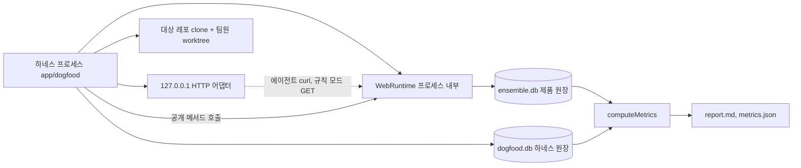
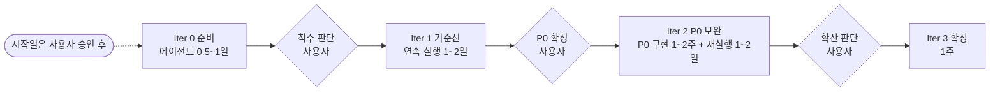

# 에이전트 전용 도그푸딩 계획

기준: jovinus302/Ensemble origin/main f71e33e, 2026-10-19. 원 계획 문서(Google Doc, 2026-10-19)의 Dogfooding 계획을 유지하되, 사람이 맡던 역할을 모두 에이전트로 바꿨다. 이 문서는 계획이다. 실제 모델 실행(live)은 사용자 승인 뒤에 한다.

관련 문서: [PM Workflow 7단계](pm-workflow.md), [기능 모판](feature-seedbed.md), [하네스 사용법](../../app/dogfood/README.md).

## 1. 목적·원칙

별도 레포의 중규모 프로젝트를 Agent 개발팀이 반복해서 만든다. 그동안 Ensemble PM Agent가 일곱 단계를 얼마나 닫는지 잰다.

- **에이전트만으로 운영한다.** 승인, 결정, 사람 몫 작업, 팀원, 마찰 기록, 현황 파악을 모두 에이전트나 코드가 맡는다.
- **Iter 1은 일부러 기능을 더하지 않는다.** 하네스는 제품 코드를 바꾸지 않는다. 증거는 run_started.productDirty=false다.
- **대상은 별도 레포다.** 도구가 깨지면 도그푸딩도 멈추고 평가가 섞이기 때문이다. 하네스는 Ensemble 저장소 밖 runDir에서 대상 레포를 clone해서만 작업한다.
- **측정은 두 원장으로만 한다.** 제품 원장(runDir/data/ensemble.db)과 하네스 원장(runDir/dogfood.db)이다. 사람의 기억이나 스톱워치는 쓰지 않는다.
- **귀속의 정본은 하네스 원장이다.** 제품 원장에는 대리 행위가 human 이벤트로 남는다. 이 원장을 실제 사람 승인의 근거로 다시 쓰지 않는다.

### 정보 위생

역할마다 볼 수 있는 정보를 나눈다. 판단이 정답을 보고 내려지면 측정이 무의미해지기 때문이다.

| 역할 | 볼 수 있는 것 | 볼 수 없는 것 |
|---|---|---|
| 결정 대리 | 화면에 보이는 정보(대기 계획, 열린 결정 요청, 권한 카드, 멈춘 작업), BACKLOG, 목표. Space 글은 관찰만 하고 다음 단계 선정에는 쓰지 않는다 | 제품 원장 전체, 하네스 원장의 진척, 지표 |
| 팀원 A·B | 자기 일감, Space 맥락, 자기 worktree | 다른 팀원 worktree, 두 원장, 지표 |
| 현황 프로브 | 조회 API(GET /api/state, /api/space, /api/tasks/:id)만 | 원장 파일, 대상 레포, 정답 |
| 마찰 기록자 | 전부(사이클 창 안의 제품 이벤트, 대리 행동, 팀원 세션, 모판) | 없음 |

## 2. 원 문서 대비 바뀐 점

| 항목 | 원 문서 | 이 계획 |
|---|---|---|
| 실행 환경 | Linux 서버나 WSL | Windows 네이티브. claude.exe 폴더를 PATH 앞에 붙이고, PM 요청 스키마를 의미가 같은 $defs/$ref로 압축하는 어댑터를 쓴다. 압축 뒤에도 한도를 넘으면 argv_limit로 정지하고 WSL이나 --pm-runtime api로 다시 돈다 |
| DB·Hindsight | 기동해야 함 | 필요 없다. SQLite 원장이 내장돼 있다(G3 해소) |
| 실행 기록 | 실행 기록(Run)에 토큰이 없음 | 원장 turn_observed 이벤트와 하네스 사용량 기록(dogfood_usage_recorded) |
| 사람 역할 | 운영자, 가상 팀원을 사람이 운영 | 모두 에이전트. 판단이 필요한 역할은 headless claude -p, 기계적인 역할은 코드 |
| 마찰 기록 위치 | Ensemble 보드의 dogfood-feedback 프로젝트 | 하네스 원장(dogfood_friction_recorded). 보드는 실험 대상이므로 측정 도구로 쓰지 않는다 |
| 기간 | 약 4~5주 | Iter 0 0.5~1일, Iter 1 연속 실행 1~2일. 시작일은 사용자 승인 뒤 |
| 토큰 | 재는 방법을 Iter 0에서 정함 | 세 경로로 수집하고 가중 토큰으로 예산을 잡는다(§8, §10) |
| 머지 | 사람이 수동 머지 | 하네스가 팀원 브랜치를 결정적으로 main에 머지하고 통합 테스트를 돌린다 |
| 재개 | 언급 없음 | 지원하지 않는다. 턴 타이머가 메모리에만 있어 고아 작업이 생긴다. 새 runDir로 다시 돈다 |

## 3. 대상 프로젝트

원 문서의 기준은 그대로다. 별도 레포, 2~3주 분량, 에픽 3~5개, 태스크 20~40개, 백엔드와 프론트 병행, 테스트로 확인 가능.

| 후보 | 데이터 | 병렬 작업 | 테스트 | 에이전트 전용 실행의 걸림돌 |
|---|---|---|---|---|
| R2P 과제 현황 대시보드 | 실제 R2P 데이터 필요 | 가능 | 가능 | 데이터와 접근 권한이 없으면 가치가 없다 |
| 회의 결정·액션아이템 검색 웹앱 | 합성 회의록 마크다운으로 자급 | 파싱·검색·UI·내보내기로 나뉨 | node --test | 없음 |
| 사내 API용 CLI 도구 | 사내 API 필요 | 프론트가 없어 제한적 | API 권한 필요 | 자격증명과 API 권한이 필요하다 |

**추천: 회의 결정·액션아이템 검색 웹앱.** 새 별도 로컬 레포로 만든다. 원격 레포 생성과 push는 외부에 영향을 주므로 하지 않는다.

- 합성 회의록만으로 데이터를 자급한다. 사내 시스템, 실명, 자격증명 없이 BE와 FE를 끝까지 만들고 테스트한다.
- 일이 파싱·검색·UI·내보내기로 나뉘어 중복과 충돌(G10·G11)을 잴 수 있다.
- "결정·이력 검색"은 Ensemble의 G2와 같은 문제라 프로브 질문이 현실적이다.
- 에픽 4~5개(파싱, 검색 API, 검색 UI, 액션아이템 추적, 내보내기), 백로그 20~30개, 반복마다 팀원 B의 solo 항목 1개를 둔다.

### 준비물 문법

BACKLOG.md:

```markdown
## E1 에픽 제목 [iter:1]
- [ ] B-01 항목 제목 — 완료 조건 (area: be)
- [ ] B-03 항목 제목 — 완료 조건 (area: be) [solo:teammate-b]
```

`[solo:teammate-b]`는 선택이다. 붙이면 그 항목은 Ensemble 밖에서 팀원 B가 구현한다(통제된 중복).

DOGFOOD_GOAL.md:

```markdown
## Iter 1
기한: 2026-11-30
테스트: npm test
```

`테스트:`, `기한:` 줄을 해석한다. 기한은 `기한: YYYY-MM-DD` 또는 `기한은|는 YYYY-MM-DD…` 줄이며([backlog.ts](../../app/dogfood/backlog.ts) parseGoal), startFree의 deadline이 되고 목표 본문에서는 빠진다. 줄이 없으면 기한 없이 시작한다(`--max-hours`는 정지 판정에만 쓴다). 나머지 줄은 목표 본문으로 PM에 전달된다.

### Iter 2 연속성

Iter 2는 `--continue-from <Iter 1 runDir>`로 돈다. 하네스는 `<그 runDir>/target/main`을 clone한다. Iter 1에서 머지된 레포 위에서 `[iter:2]` 백로그를 이어 간다.

스모크용 시드 meeting-notes-mini(app/dogfood/seed-project)가 같은 문법을 쓴다. 규칙 모드로 claude 없이 01→07→02를 한 바퀴 돈다.

## 4. 팀 구성

원 문서 표 4행은 그대로 두고 열 3개를 더했다. 그 아래 4행은 에이전트 전용으로 추가한 역할이다.

| 역할 | 누가 | 하는 일 | 에이전트 | 실행 수단과 이유 | 제품 안 신원 |
|---|---|---|---|---|---|
| PM Agent | Ensemble pm | 분해·배정·다음 결정 | Ensemble PM Agent(시험 대상) | WebRuntime 안의 ProjectManager. 제품 기본값을 그대로 쓴다. 대체가 아니라 시험 대상이다 | PM |
| Dev·UX Agent | Ensemble deva·uxa | worktree에서 태스크 실행 | Ensemble 실행 Agent(research-agent, prototype-agent) | 제품의 ClaudeSessionConnector. 작업 폴더는 제품 기본(runDir/agents)이다 | 실행 Agent |
| 가상 팀원 1~2명 | 사람이 로컬 Claude Code 세션을 운영 | Ensemble 밖에서 구현하고 스킬로 보고 | 가상 팀원 A(board-first), B(local-first, 계획된 solo 항목) | headless claude -p를 팀원별 git worktree에서 실행한다. 사람 세션 운영을 대신하며 Ensemble 밖 구현이라는 조건을 지킨다 | A는 designer 멤버이면서 Space 참여자 teammate-a. B는 owner가 연결한 Space 참여자 teammate-b일 뿐 멤버가 아니다 |
| 마찰 기록자 | 운영자 1명 | 불편·개입을 그때그때 기록 | 마찰 기록자 에이전트 | 결정적 규칙 R1~R17(코드)에 live에서는 headless claude -p로 확정·병합·갭 매핑을 더한다 | 제품 밖(하네스 원장에만 기록) |
| 결정 대리 | 승인하는 사람과 결정권자, 디자이너 | 계획 카드 승인, 결정 요청 응답, 멈춘 작업 처리, 다음 단계 요청 | 결정 대리(owner·designer) | headless claude -p를 `--tools ''`와 `--json-schema`로 실행해 판단만 받고, 하네스가 공개 메서드를 호출한다 | owner·designer 멤버 명의의 human 이벤트 |
| 사람 몫 작업 대리 | owner 담당 비코드 작업을 하는 사람 | 합성 자료로 비코드 작업 결과 제출 | 사람 몫 작업 대리 | headless claude -p, 도구는 Read·Glob·Grep만. 규칙 모드는 결정적 템플릿 | owner 명의의 result_submitted |
| 현황 프로브 | 현황을 알아내는 운영자 | "누가 무엇을 어디까지"에 답하고 걸린 시간 기록 | 현황 파악 프로브 | headless claude -p, 도구는 `Bash(curl *)`만. 기억 없이 조회 API로만 답한다 | 제품 밖(HTTP 조회만) |
| 하네스 운영자 | 운영자(진행·머지·환경 준비) | 시작·정지·순서·예산·머지 | 하네스(코드) | Node+tsx 코드. LLM을 쓰지 않는다 | 제품 밖. 제품 원장에 직접 쓰지 않는다 |

**실행 수단을 고른 이유.** 판단이 필요한 역할은 무인 루프, 호출별 맥락 격리, 구조화 출력, usage 계량이 필요하다. 서브에이전트는 이를 줄 수 없어 headless claude -p를 쓴다. 기계적인 역할은 결과가 결정적이어야 해서 코드로 돌린다.

**역할 프롬프트를 app/dogfood/roles에 두는 이유.** 개발 세션에 자동으로 노출되지 않게 하려는 것이다. .claude/agents나 CLAUDE.md에 두면 이 저장소를 여는 개발 세션이 역할 지시를 읽는다. 하네스는 프롬프트의 해시를 run_started.promptHashes에 남겨 Iter 1과 Iter 2가 같은 정책인지 증명한다.

## 5. 실행 구조와 사이클 순서



하네스 프로세스 1개(app/dogfood, tsx)가 다섯 가지를 한다.

1. runDir 잠금(.lock, pid)을 잡고 WebRuntime을 직접 만든다. live에서만 timers를 켜고, 사용량 계량 래퍼(MeteredLlm)를 주입한다.
2. route.ts의 GET/POST를 127.0.0.1에 node:http 어댑터로 노출한다. 에이전트의 curl과 규칙 모드의 GET만 쓴다.
3. 사람 역할의 행동은 공개 메서드로 직접 한다(pm.decideCard, decide, resolveTask, message, startFree). startFree는 초안을 쓰는 동안 블록하므로 HTTP를 쓰지 않는다.
4. 대상 레포를 runDir/target/main으로 clone하고 팀원별 worktree를 만든다. 팀원 브랜치는 하네스가 결정적으로 main에 머지한다.
5. 원장은 둘이다. 지표와 리포트는 이 둘만 읽는다.

Next 서버를 자식 프로세스로 띄우는 안은 버렸다. 그 대가로 결정적 tick, 연결 코드 콜백, PM 계량·argv 어댑터, 규칙 모드 스모크를 얻는다. 잃는 것은 실행 중 대시보드다.

### 사이클 순서

1. 준비: runDir이 없거나 비어 있어야 한다. 잠금을 잡고, 대상 레포를 clone하고, 팀원 worktree를 만든다.
2. startHost: 환경 변수를 설정하고(SLACK_* 삭제, 생성 직후 재확인) WebRuntime과 HTTP 어댑터를 띄운다. run_started에 ensembleCommit, productDirty, adapters, promptHashes를 기록한다.
3. startFree(goal)를 부르고 대기 계획이 1건인지 확인한다. 없으면 R17 마찰을 남기고 최대 2회 재시도한다. 그래도 없으면 error/plan_draft_failed로 정지한다. 이어서 팀원 Space를 연결한다.
4. 사이클: (규칙 모드면 tick) → settle → 결정 대리 owner → 결정 대리 designer → 대기 중인 사람 결과 재확인 → 사람 몫 작업 대리 → settle → 팀원 A → 팀원 B → 하네스 머지·통합 테스트 → settle → 다음 단계 요청 → settle → (live) 사용량 수집 → 마찰 기록 → 프로브 → cycle_finished → 리포트 갱신. infra_pause 구간에는 대리·팀원·프로브를 건너뛴다.
5. 사람 결과 제출: 먼저 HTTP와 같은 경로(runtime.message)로 보낸다. 처리 증거가 생길 때까지 기다린다. 의도한 작업의 결과로 인식되지 않았을 때만 taskId를 붙여 대체 제출한다(R3). 다른 작업으로 잘못 갔으면 R15로 따로 기록한다.
6. 측정: PM은 MeteredLlm, 실행 Agent는 Claude Code 트랜스크립트, 하네스 역할은 claude -p 결과로 dogfood_usage_recorded를 남긴다.
7. 매 사이클 metrics.json과 report.md를 덮어쓴다.
8. 정지: 신호가 오면 진행 중인 claude -p를 끝내고 run_stopped → 리포트 → host 종료 → 자식 pid 정리 → 잠금 해제 순서로 정리한다.

## 6. 결정 대리 정책

제품에서 실제로 실행되는 분기만 남겼다. 제품 기본값(자동 행동 상한 12, 보완 상한 2)은 바꾸지 않는다.

1. **계획 카드:** 승인한다. 부적합하면 dissent 노트(gapHint G5·G6)를 남긴다.
2. **권한 카드:** set_availability는 승인한다. goal_change·deadline_change가 하나라도 있으면 거절한다(override). 목표와 기한은 DOGFOOD_GOAL이 정하고, 제품 안에서 바꾸지 않는다.
3. **결정 요청:** 추천안 승인이 기본이다. missing_info에서 추천 옵션에 답 문구가 없으면 목표·BACKLOG 범위 안의 최소 답을 쓴다. plan_change나 assignment가 이번 반복의 아직 검증되지 않은 B-id 작업을 지우면 거절한다. stuck_work는 같은 대상의 두 번째 처리면 accept, 처음이면 cancel이다. 담당자 편집은 하지 않는다(제품에 그 경로가 없다).
4. **멈춘 작업:** 제품이 허용한 행동만 쓴다. 결과가 있고 (사유에 '보완'이 있거나, 재확인이 가능하거나, 막힘 2회 이상)이면 accept(owner만). 그렇지 않고 막힘이 2회 미만이면 retry다. 그 밖에는 노트만 남긴다. 인프라 사유의 막힘(infra)은 막힘 횟수에 넣지 않는다. 하네스가 이 막힘을 dogfood_infra_pause(source: ensemble-agent)로 남기고([role-context.ts](../../app/dogfood/role-context.ts) recordProductInfraPauses), infra_pause 동안 대리 단계를 건너뛴다. 대기가 끝나면(인박스 infraRetryReady) 규칙·live 대리 모두 그 작업을 retry할 수 있다([proxy.ts](../../app/dogfood/proxy.ts) holdsForInfra).
5. **다음 단계(owner만):** 유휴일 때만 한다. 유휴는 진행 중 작업, 열린 결정, 대기 계획이 모두 없고, ready가 없거나 상한에 닿았을 때다. 후보는 BACKLOG 순서에서 이번 반복의 !boardDone && !onBoard 항목이다. Space 게시는 보지 않는다(바쁜 결정권자 모델이며 계획 표본 중복을 만들기 위한 것이다). 사이클당 1회, 효과가 없으면 2사이클 기다리고, 3회 연속 실패하면 그 반복에서 멈춘다. 담당자 지시는 넣지 않는다(기본 `--next-step-assignee pm`).
6. **반복 제한:** 같은 대상에 같은 행동은 2회까지, 패스당 6개까지다. 다른 멤버 명의로는 행동하지 않는다.

실패하면 규칙 판단(ruleDecide)으로 폴백하고 harnessNoise로 표시한다. 인프라 실패는 폴백하지 않고 infra_pause로 처리한다.

### 개입 유형 6종

하네스가 결정적으로 분류한다. 판정 근거는 모델이 아니라 행동 종류다.

| 유형 | 해당 행동 | 집계 |
|---|---|---|
| rubber_stamp | 계획 승인, 추천 approve·choose, 수락 | planned |
| override | 거절, 추천 외 choose, 권한 카드 거절, 계획 초안 재시도 | counted |
| answer | missing_info 답 | counted |
| recover | resolve_task | counted |
| initiate | next_step_request | counted |
| defer | 노트만 남김 | 집계 안 함 |

counted는 위 override·answer·recover·initiate에 사람 결과 대체 제출(human_result_fallback), 오라우팅(human_result_misrouted), 수동 머지(manual_merge), owner 코드 작업 재지정(R14)을 더한 값이다. planned는 rubber_stamp, 팀원 Space 연결 확인(teammate_linked), 인식된 첫 결과 제출이다. 원장 기준 사람 행위 수(ledgerHumanActs)는 따로 세어 교차 확인에만 쓴다. 태스크당 개입 횟수는 counted ÷ 작업 수다.

사람 개입 13곳의 정의와 도그푸딩 처리는 [pm-workflow.md §5](pm-workflow.md#5-사람-개입-지점)에 있다.

## 7. Iteration

원 문서 표의 열(회차 | 기간 | 내용 | 뒤따르는 판단)을 그대로 두고 열 3개를 더했다.

| 회차 | 기간 | 내용 | 뒤따르는 판단 | 에이전트 기간 | 종료 판단 주체 | 에이전트 전용 변경 |
|---|---|---|---|---|---|---|
| Iter 0 준비 | 2~3일 | Linux·WSL 실행 환경, DB·Hindsight 기동, 측정 양식·대상 레포 | 착수 결정: 대상 프로젝트·환경 확정 | 0.5~1일 | 하네스가 체크리스트를 판정해 리포트에 쓰고, 착수는 사용자가 결정 | Windows 네이티브에 PATH 보정과 PM 스키마 압축 어댑터. DB·Hindsight는 불필요. 측정 양식은 하네스 원장으로 대체 |
| Iter 1 기준선 | 1주 | 지금 기능 그대로, 에픽 1~2개 진행, 마찰 로그 기록 | P0 확정: 마찰 로그를 모판에 매핑 | 연속 실행 1~2일(최대 48시간·120사이클). 같은 설정으로 2회 권장 | 리포트가 G별 점수로 제안하고 사용자가 확정 | 제품 변경 0(productDirty=false). 마찰·현황·개입을 에이전트와 원장이 기록. 07 고리는 결정 대리가 닫고 initiate로 센다 |
| Iter 2 P0 보완 | 1~2주 | P0 갭 구현, 다음 에픽 진행, 지표를 Iter 1과 비교 | — | P0 구현 1~2주(architect 설계 → implementer 구현, 별도 PR) + 재실행 1~2일 | 핵심 두 지표와 beyondPlanByPm을 Iter 1과 비교. 개선이 없으면 재매핑을 제안하고 사용자가 결정 | 대리 정책과 하네스 코드를 바꾸지 않는다(promptHashes 동일). G7이 들어가면 initiate가 줄고 beyondPlanByPm이 늘어야 한다 |
| Iter 3 확장 | 1주 | Slack 연계(G12), 사람 1~2명 참여, 확산 판단 자료 | 확산 판단: R2P 다른 과제로 넓힐지 | 1주 | 에이전트는 권고까지만. 확산은 사용자가 결정 | 사람 1~2명 참여를 팀원 에이전트 3~4명으로 바꾼다. Slack 계정과 권한은 사람이 제공 |

Iter 1은 일부러 기능을 더하지 않는다. 그래야 Iter 2에서 P0를 넣은 효과를 비교할 수 있다.

Iter 2의 P0 구현 방향은 [feature-seedbed.md §4](feature-seedbed.md)에 있다. 제품이 argv 문제를 고치면 adapters가 달라지므로 비교표에 표시한다.

### 로드맵



### Iter 0 canary 합격 기준

시드로 live canary를 돈다. 사용자 승인 뒤에만 한다. 합격 기준은 아래 여섯 가지다.

- (a) 2사이클 이상에서 PM·Agent·팀원·대리의 실제 호출이 성공한다.
- (b) ensemble-agent usage가 0보다 크다.
- (c) PmArgvAdapter 압축 스키마로 PM 해석이 성공한다(preflight에서 합성 메시지 60건 상태로 claude -p 1회).
- (d) next_step으로 beyond_plan proxy가 1건 이상 생긴다.
- (e) 사람 결과 HTTP 첫 제출 인식률이 기록된다.
- (f) `--next-step-assignee designer`를 쓸 거라면 designer 배정 결정 승인이 성공한다.

## 8. 측정 지표

원 문서 6행(지표 | 재는 방법 | 보는 것)은 그대로 두고 열 3개를 더했다. 마지막 2행은 추가한 것이다. 핵심 지표는 중복·재구현 건수와 현황 파악 시간이다. 두 지표가 Iter 1 대비 Iter 2에서 줄어야 가치를 증명한 것이다. 목표치는 Iter 1 기준선을 본 뒤 정한다.

**공식의 정본은 app/dogfood/metrics.ts다.** 아래 공식은 요약이다. 다르면 코드가 맞다.

| 지표 | 재는 방법 | 보는 것 | 출처 | 공식 | 에이전트 측정 |
|---|---|---|---|---|---|
| 중복·재구현 건수 | 이미 있던 기능을 다시 만든 건을 마찰 로그에 기록 | 핵심 가치 | 하네스 원장(plantedSolo, teammate_session, overlap_candidate, friction duplicate), 제품 원장(plan_committed, task_meta_set의 B-id, task_start_reserved) | total = 계획 표본 realized + 자연 발생 confirmed. selfRework(같은 행위자의 같은 B-id 재구현)는 따로 보고 | 계획 표본은 BACKLOG 순서대로 요청하므로 Iter 1에서 실제로 생긴다(기대 realized 1). 자연 발생분은 마찰 기록자가 후보 key를 확인했을 때만 센다. 같은 사건을 두 번 세지 않는다 |
| 현황 파악 시간 | "누가 무엇을 어디까지"를 알아내는 데 쓴 시간을 운영자가 기록 | 핵심 가치 | 하네스 원장 dogfood_status_probe(durationMs, correct, total, failed) | 프로브 durationMs 중앙값, 정답률 0.8 이상인 프로브의 중앙값(파악 성공 시간), 평균 정답률. 실행이 실패한 프로브(failed: true)는 분모에서 빼고 failedProbes로 따로 센다. 인프라 실패는 프로브를 기록하지 않고 다음 사이클에 다시 한다 | 기억 없는 프로브가 조회 API만으로 답한다. 정답은 프로브가 볼 수 있는 정보와 같은 규칙으로 만든다. 팀원 질문의 기대값은 git이 아니라 Space 글로 정한다 |
| 태스크당 사람 개입 횟수 | 수정·재요청·수동 머지 횟수 | 조율 부담 | 하네스 원장(proxy_action, human_task_submitted, manual_integration)이 정본, 제품 원장 사람 입력 이벤트는 교차 확인 | perTask = counted ÷ 작업 수(§6 개입 유형) | 대리 행위는 제품 원장에 human으로 남으므로 하네스 원장이 정본이다. 차이는 리포트에 표시한다 |
| 실행 성공률·재실행 비율 | GET /api/runs의 상태 | 실행 품질 | 제품 원장(task_started, turn_observed, task_blocked, revision_requested, task_checked) | successRate = 성공 ÷ (성공 + 실패), rerunRatio = (턴 수 − 작업 수) ÷ 턴 수, firstPassRate | 원장 계산이며 판단이 필요 없다. 인프라 실패는 분모에서 빼서 제품 품질과 섞지 않는다 |
| PM 분해 품질 | PM이 만든 태스크 중 사람이 고치거나 취소한 비율 | PM Agent 품질 | 제품 원장(plan_proposed, plan_decided, decision_requested, decision_resolved), 하네스 원장 dissent 노트 | 분자(취소·수정·거절된 작업) ÷ 분모(PM이 만든 작업). proxyAgreement = 1 − dissent ÷ ok 대리 행동 | 사람이 고치던 판단을 결정 대리가 정책으로 한다. 승인 편향은 rubber_stamp 수와 proxyAgreement로 드러낸다 |
| 토큰·실행 시간 | 실행별 사용량과 소요 시간 | 비용 | 하네스 원장 dogfood_usage_recorded(pm, ensemble-agent, harness), 제품 원장 시각 | weighted = (입력 − 캐시읽기 − 캐시생성) + 출력 + 0.1×캐시읽기 + 1.25×캐시생성. PM 출처는 입력 전체 | 제품이 토큰을 남기지 않으므로(G15) 하네스가 세 경로로 모은다. ensemble-agent usage가 0건이면 '측정 불가'다 |
| 고리 닫힘 | 07에서 정한 후속 태스크가 02로 돌아갔는지(추가) | G7 효과 | 제품 원장(task_start_reserved.trigger, plan_committed, task_meta_set.origin, decision_requested.payload), 하네스 원장 next_step_request | beyond_plan(계획 밖 새 작업)의 주체를 근거 메시지로 판정해 pm·proxy·teammate·unknown으로 나눈다. pmLoopRatio = beyond_plan(pm) ÷ beyond_plan | Iter 1 기대 기준선은 beyondPlanByPm = 0이다. G7 구현 뒤에는 근거 없는 PM 요청이 pm으로 집계된다 |
| 통합 건강도 | 하네스가 대상 레포 main에서 테스트를 돌려 잼(추가) | 보조(레포 반영) | 하네스 원장(manual_integration, integration_test, backlog_progress), 제품 원장 task_checked | testPassRate, checkedButRed, verifiedDone, boardOnly = boardDone − verifiedDone | TrustedValidator가 없어 checked가 테스트 통과를 뜻하지 않는다(G14). 정지 판정 done은 verifiedDone만 쓴다 |

## 9. 마찰 기록

마찰은 하네스 원장에 남긴다. 규칙 R1~R17과 갭 매핑은 [feature-seedbed.md §6](feature-seedbed.md)에 있다.

- **규칙과 에이전트 확정을 구분한다.** 규칙은 코드로 항상 실행된다(recordedBy rule). 에이전트 확정은 live에서 사이클이 끝날 때 마찰 기록자가 근거 이벤트 id를 확인하고 기록한다(recordedBy agent). duplicate는 후보 key를 확인했을 때만 기록한다.
- **잡음은 점수에서 뺀다.** 대리 폴백과 인프라 실패 같은 하네스 잡음은 harnessNoise=true로 표시한다.
- **G17부터.** 맞는 갭이 없으면 NEW로 올리고(dogfood_gap_proposed), 사용자가 확정하면 모판에 G17부터 추가한다. 확정 절차는 feature-seedbed.md §7이다.
- 심각도는 high 3점, medium 2점, low 1점이다. Iter 1 리포트가 G별로 합산해 P0 제안을 만든다.

## 10. 예산과 안전장치

| 항목 | 값 |
|---|---|
| 가중 토큰 예산 | 20M(`--budget-tokens`). 캐시 읽기는 0.1배, 캐시 생성은 1.25배 |
| 팀원 1명당 | $3(`--teammate-budget-usd`) |
| 결정 대리·기록자·프로브 호출당 | $0.5(`--proxy-budget-usd`) |
| 세션 시간 | 25분(`--session-timeout-minutes`) |
| 전체 시간·사이클 | 48시간, 120사이클 |
| 진척 정지 | 의미 있는 진척 없이 3사이클이면 정지 |
| 인프라 실패 | 대기(infra_pause). 6회 연속이면 정지(infra) |

안전장치는 아래와 같다.

- 토큰은 secrets 파일과 환경 변수로만 다룬다. 로그에서는 `***`로 치환한다.
- HTTP 어댑터는 127.0.0.1에만 바인딩한다.
- 대상 레포는 clone에서만 작업한다. runDir은 Ensemble 저장소 밖이어야 한다.
- SLACK_* 환경 변수를 제거한다. `--env-file`은 SLACK_* 줄을 뺀 복사본(`runDir/.env.dogfood`)만 제품이 읽고, process.env의 SLACK_*도 지우며, 걸러낸 키 이름은 run.json `strippedSlackKeys`에 남는다([config.ts](../../app/dogfood/config.ts) applyProductEnv). WebRuntime 생성 직후에도 SLACK_*가 남아 있으면 중단한다([host.ts](../../app/dogfood/host.ts)).
- 실행 중 같은 data로 Next를 띄우지 않는다. PM이 둘이 된다. 하네스 이중 실행은 runDir 잠금(.lock)이 막는다.
- 같은 계정의 다른 Claude 세션을 자제하고 `CLAUDE_CODE_OAUTH_TOKEN`을 권장한다. 같은 OAuth 자격을 여러 프로세스가 쓰면 갱신 경합이 생긴다.
- 장시간 실행 중 절전을 해제한다.
- **실제 모델 실행은 사용자 승인 뒤에 한다.** 구현과 규칙 모드 스모크까지만 자동으로 한다.

## 11. 실행 방법

```sh
cd app

# 환경 점검(live 호출 제외)
npm run dogfood -- preflight --skip-live

# 규칙 모드 스모크(claude 없이 시드로 01→07→02)
npm run dogfood -- smoke

# 시드로 2사이클(live는 사용자 승인 뒤)
npm run dogfood -- run --target seed --max-cycles 2

# Iter 1 기준선
npm run dogfood -- run --target <대상 git 레포> --iteration 1

# Iter 2: Iter 1에서 머지된 레포 위에서 이어 간다
npm run dogfood -- run --continue-from <Iter1 runDir> --iteration 2

# 리포트와 Iter 1 비교
npm run dogfood -- report --run-dir <dir> --compare <Iter1 dir>
```

플래그 전체와 runDir 구조는 [app/dogfood/README.md](../../app/dogfood/README.md)에 있다.

## 12. 원 문서의 결정 사항과 다음 액션

원 문서의 다섯 항목이 이 계획에서 어떻게 처리되는지 정리했다.

| 원 항목 | 이 계획에서의 처리 | 남은 사용자 결정 |
|---|---|---|
| Dogfooding 대상 프로젝트 선정 | 회의 결정·액션아이템 검색 웹앱을 추천한다(§3). 합성 회의록을 쓰는 새 로컬 레포다 | 대상 확정, 원격 레포 생성 여부 |
| 실행 서버 환경 결정(Linux 또는 WSL) | Windows 네이티브와 어댑터로 처리한다(§2). WSL과 `--pm-runtime api`는 대안이다 | argv 전략 확정(어댑터, WSL, api) |
| Iter 1 시작일과 마찰 기록 담당자 지정 | 담당자는 마찰 기록자 에이전트다(§4). 시작일은 canary 승인 뒤다(§7) | canary 승인과 시작일 |
| PM Agent Workflow 7단계 확정 | [pm-workflow.md](pm-workflow.md)를 초안으로 채택했다 | 정의 확정 |
| Iter 1 종료 후 모판 우선순위 확정 | Iter 1 리포트가 G별 점수와 P0 제안 절을 만든다 | 리포트 §8을 보고 우선순위 확정 |

## 13. 위험과 열린 결정

### 위험

| 위험 | 대응 |
|---|---|
| 원장에는 대리 행위가 human으로 남는다 | 이 원장을 실제 사람 승인의 근거로 쓰지 않는다. 귀속의 정본은 하네스 원장이다(§1) |
| 결정 대리가 추천 승인 쪽으로 치우친다 | rubber_stamp와 proxyAgreement를 따로 보고하고 promptHashes로 정책을 고정한다 |
| Windows argv 한도. $ref 압축 뒤에도 메시지 수에 비례하는 부분이 남는다 | preflight live로 $ref 지원을 확인한다. 한도를 넘으면 argv_limit로 정지하고 WSL이나 api로 다시 돈다. 기준선 차이로 기록한다 |
| 사람 결과 대체 제출은 대시보드 사용자가 쓸 수 없는 경로다 | 대체는 R3, 오라우팅은 R15로 집계한다. 처리 증거 없이 시간만 지났으면 대체하지 않아 이중 제출을 막는다 |
| result_submitted가 작업 상태와 무관하게 submitted로 되돌린다 | 대체 직전에 상태를 다시 확인한다. 사람 경로의 같은 오염은 Iter 2 G1 후보다 |
| 결정권자 메시지로 디자이너에게 일을 맡기는 경로는 권한 충돌로 실패할 수 있다 | 기본은 담당자 지시 없이 PM 라우팅에 맡긴다. designer 모드는 canary를 통과해야 쓴다 |
| B 항목이 Agent에게 가면 대상 레포 밖에서 끝난다(board_only) | 팀원 A의 통합 일감으로 옮기고 R9와 manual_merge로 집계한다. 정지 판정은 verified 기준이다 |
| 재개를 지원하지 않는다 | 신호 처리, 자식 pid 정리, 잠금, 절전 안내로 줄인다. 반복마다 2회 실행을 권장한다 |
| 인프라 실패(사용량 상한, 인증 만료, 레이트 리밋) | infra_pause로 대기하고 지표 분모에서 뺀다. OAuth 토큰 사용과 다른 세션 자제를 안내한다 |
| WebRuntime·route.ts의 공개 멤버가 바뀌면 하네스가 깨진다 | 규칙 모드 스모크와 런타임 통합 테스트가 npm test에 있어 바로 드러난다 |
| 첫 계획이 4역할 템플릿이라 개발 대상과 맞지 않는다 | 시간과 토큰을 쓰지만 그 자체가 측정 대상이다(G5, R11) |
| stuck_work 결정 요청은 4시간 이상 막힌 작업에만 나온다 | 짧은 실행에서는 거의 관측되지 않는다 |
| 실행 Agent 토큰은 Claude Code 트랜스크립트 형식에 의존한다 | 실패하면 '측정 불가'로 둔다. codex Agent는 계량하지 못하고 codex PM은 지원하지 않는다 |
| LLM 비결정성으로 Iter 1과 2의 비교가 흔들린다 | 같은 시드, 프롬프트 해시, 모델로 2회 실행을 권장한다 |
| Space 토큰 유출, liaison의 worktree 전체 읽기 | secrets 파일과 환경 변수로만 다루고 127.0.0.1에만 바인딩한다. 실제 레포에서는 allowedPaths를 좁힌다 |
| 하네스 역할은 사용자 전역 설정을 차단하지만 제품 실행 Agent는 기본값을 쓴다 | 이 차이는 기준선의 일부로 기록한다 |

### 열린 결정

| 질문 | 기본값 | 근거 |
|---|---|---|
| 대상 프로젝트를 무엇으로 할 것인가 | 회의 결정·액션아이템 검색 웹앱(새 로컬 레포, 원격 없음) | 외부 시스템 없이 BE+FE+테스트를 끝까지 돌릴 수 있다. 원격 생성과 push는 외부 영향이라 사용자 결정이다 |
| Windows live 전략(어댑터, WSL, api) | Windows 네이티브와 $ref 압축 어댑터 | 사용자 환경 그대로이고 제품 PM 경로를 유지한다. API 키·비용·WSL 설치는 사용자만 정한다 |
| live canary와 Iter 1 본 실행의 시작과 예산 | 구현과 스모크까지만 자동. live는 사용자 승인 뒤. 상한은 §10 | 구독 사용량과 비용이 든다. canary 사용량을 보고 조정한다 |
| `--next-step-assignee`를 지정할 것인가 | pm | designer 경로는 권한 충돌 위험이 있어 canary로 확인하기 전에는 쓰지 않는다 |
| Iter 1 뒤 P0 확정과 Iter 3 확산 판단의 주체 | 리포트 제안을 근거로 사용자가 확정 | 우선순위와 조직 자원은 제품 결정이라 대리 권한 밖이다 |
| PM Workflow 7단계 정의를 확정할 것인가 | pm-workflow.md를 초안으로 채택 | 정의 확정은 제품 결정이다. 기준 커밋이 바뀌면 상태를 다시 판정한다 |
