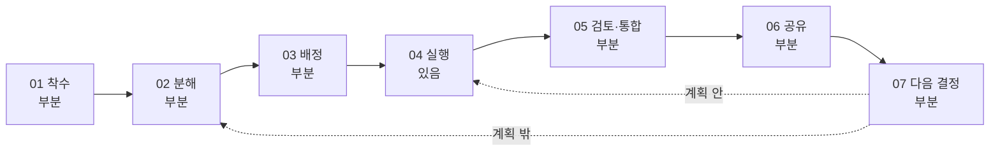

# PM Agent Workflow 7단계 정의

기준: jovinus302/Ensemble origin/main f71e33e(PR #91), 2026-10-19 코드 확인. 원 계획 문서의 상태 열은 Ensemble-r2p 기준이었고, 이 문서는 이 저장소 코드로 다시 판정했다.

상태 범례: **있음** = 코드로 끝까지 닫힌다. **부분** = 일부 경로만 있거나 조건이 붙는다. **없음** = 코드가 없다.

## 1. 단계 정의

| 단계 | PM Agent가 하는 일 | intent 역할 | 대표 원장 이벤트 |
|---|---|---|---|
| 01 착수 | 목표·기한·결정권자·팀(사람·Agent·개인 Agent)·위임 범위를 받아 프로젝트를 열고, 첫 계획 초안을 결정권자 승인으로 확정할 준비를 한다. | Context Aggregator·Goal/State Manager | member_joined·goal_set·participant_linked |
| 02 분해 | 목표와 요청을 완료 조건·의존·담당 후보가 있는 작업 트리로 나누고, 진행 중 새 요청과 결과에서 나온 일을 계획 vN+1에 반영한다. | Goal/State Manager | plan_proposed·plan_decided·plan_committed·task_meta_set(origin) |
| 03 배정 | 작업마다 실행자(Agent 역할 또는 사람)를 사유와 함께 정한다. 사람의 새 약속은 본인 수락을 받고, Agent 몫은 실행 대기열에 넣는다. | Coordinator | task_meta_set(routing)·decision_requested(assignment) |
| 04 실행 | 배정된 Agent·사람이 맥락과 인계 조건을 받아 일한다. 결과·질문·막힘은 원장으로 돌아온다. | Action Agent | task_start_reserved·task_started·turn_observed·result_submitted·task_blocked·space_post_recorded |
| 05 검토·통합 | 결과가 인계 조건을 채웠는지 근거로 판정한다. 부족하면 보완을 요청하고, 확인된 결과를 대상 레포에 통합한다. | Goal/State Manager | handoff_reviewed·task_checked·revision_requested |
| 06 공유 | 누가 무엇을 어디까지 했는지를 사람과 각자의 Agent 세션이 평소 쓰는 곳에서 알 수 있게 한다. | Coordinator·Organizational Memory | pm_spoke·change_notified·space_context_read |
| 07 다음 결정 | 결과나 상황 변화가 생기면 다음 작업과 결정을 먼저 제안한다. 계획 안 다음 작업은 시작하고(07→04), 계획 밖 후속 작업은 02로 돌려 고리를 닫는다(07→02). | Proactive PM | task_start_reserved(trigger)·decision_requested(stuck_work)·personal_request_created·action_limit_reached |

## 2. 단계 흐름

07→04는 PM이 닫는다. 다만 planStarts는 ready 작업을 모두 예약한다([transitions.ts:14-25](../../app/packages/core/src/transitions.ts)). 07→02는 사람 메시지로만 닫힌다([coordination.ts:64-68](../../app/packages/orchestrator/src/coordination.ts)).

## 3. 현재 상태

| 단계 | 상태 | 지금 있는 것 | 근거 | 갭 | 관련 모판 ID | 도그푸딩 관찰 |
|---|---|---|---|---|---|---|
| 01 착수 | 부분 | startFree(POST /api/free/start)가 goal_set과 목표 메시지를 남기고 계획 초안(plan_proposed)을 만든다. 초안 작성에 실패해도 예외를 던지지 않고, 채널에 '다시 시작해 주세요' 안내만 남긴다. 팀은 seed()가 owner·designer·research-agent·prototype-agent로 고정해 만든다. | [runtime.ts:384-397](../../app/apps/web/lib/runtime.ts) [runtime.ts:261-278](../../app/apps/web/lib/runtime.ts) [planning.ts:37-47](../../app/packages/orchestrator/src/planning.ts) [planning.ts:173-179](../../app/packages/orchestrator/src/planning.ts) [route.ts:186-197](../../app/apps/web/app/api/%5B...path%5D/route.ts) [plan-ops.ts:33](../../app/packages/core/src/plan-ops.ts) | 멤버를 추가하거나 역할을 지정하는 경로가 없다(G13). 런타임 하나에 활성 프로젝트가 하나뿐이다. Slack 착수는 실험 단계다(G12). 초안 실패를 재시도하려면 사람이 다시 시작해야 한다. | G13·G12 | 하네스 운영자가 runtime.startFree를 직접 호출한다. 그 뒤 pendingPlans가 1건인지 확인하고, 없으면 R17 마찰을 남기고 최대 2회 재시도한다(override 개입). 그래도 없으면 error/plan_draft_failed로 정지한다. 결정 대리(owner)는 계획 카드를 승인한다. 연결 확인 코드는 announceLinkCode로 수집한다. 마찰 기록자는 R11(템플릿 부적합)을 관찰한다. |
| 02 분해 | 부분 | 첫 계획은 코드가 고정한 4역할 템플릿을 모델이 채운다. 그 뒤에는 Coordinator가 사람 메시지를 create_task·split_task·cancel_task 연산으로 해석해 plan_committed vN+1을 쓴다. create_task의 sourceMessageIds는 사람 메시지 enum(minItems 1)이어야 한다. 결정 요청을 거쳐 반영된 연산은 근거가 'decision-answer:<requestId>'로 바뀌어 기록된다. | [planning.ts:24](../../app/packages/orchestrator/src/planning.ts) [planning.ts:37-47](../../app/packages/orchestrator/src/planning.ts) [coordination.ts:64-91](../../app/packages/orchestrator/src/coordination.ts) [decision-flow.ts:131-135](../../app/packages/orchestrator/src/decision-flow.ts) [plan-ops.ts:13-35](../../app/packages/core/src/plan-ops.ts) [fake-connector.ts:216](../../app/apps/web/lib/fake-connector.ts) | 착수할 때 개발 에픽과 백로그를 한 번에 분해하지 못한다(G5). 결과에서 나온 후속 일을 PM이 스스로 계획 밖 작업으로 만들지 못한다(G7). Windows CLI 런타임에서는 해석 스키마가 사람 메시지 수에 비례해 커져, 명령줄 한도를 넘으면 해석이 실패한다(G14). | G5·G7·G14 | Ensemble PM이 분해한다. 결정 대리(owner)가 유휴 상태에서 BACKLOG 순서대로 '[B-xx] 제목을 만들어 주세요' 요청을 보낸다. 'PM 분해 품질'과 '07→02 고리 닫힘' 지표로 잰다. |
| 03 배정 | 부분 | routeTask가 역할이 맞는 Agent를 고르고, 맞는 Agent가 없으면 사유 enum과 함께 사람(제안된 사람, 없으면 결정권자)에게 보낸다. 진행 중에 새로 생긴 사람 작업은 assignment 결정 요청으로 본인 수락을 받는다. 첫 계획의 사람 작업(interview→결정권자, flow→designer)은 결정권자가 계획을 승인하는 것만으로 배정·예약된다. 사람 작업은 실행 대기열에 넣지 않고 채널에 안내만 한다. | [routing.ts:17](../../app/packages/core/src/routing.ts) [routing.ts:51-68](../../app/packages/core/src/routing.ts) [roles.ts:19-52](../../app/packages/agents/src/roles.ts) [planning.ts:41-42](../../app/packages/orchestrator/src/planning.ts) [coordination.ts:675-687](../../app/packages/orchestrator/src/coordination.ts) [plan-ops.ts:372-383](../../app/packages/core/src/plan-ops.ts) [dispatch.ts:265-274](../../app/packages/orchestrator/src/dispatch.ts) | Agent 역할이 research·prototype 두 가지뿐이다(G6). 개인 Agent(Space 참여자)는 담당자가 될 수 없다. 멤버 구성은 seed로 고정돼 있다(G13). 결정 요청에서 담당자를 바꿀 수 없다(editable은 title·priority뿐). 결정권자 메시지로 다른 사람에게 일을 맡기면 scope_add와 human_commitment 권한이 모두 필요해서, 수락 경로가 실패할 수 있다(canary로 확인). | G6·G13·G4 | Ensemble PM이 라우팅한다. 수락 카드에는 결정 대리가 요청 대상 본인 명의로만 답한다. 수락은 계획된 입력으로 분류한다. owner에게 배정된 B-id 코드 작업은 R14(G13) 마찰로 기록하고 팀원 A가 owner 대행으로 수행한다. |
| 04 실행 | 있음 | SessionRunner가 <ENSEMBLE_AGENT_WORKSPACE_ROOT>/<projectId>/<agentId> 폴더에서 claude·codex 턴을 실행하고, result_report의 파일을 첨부로 고정한다. 제한 시간 초과, 세션 오류, 결과 거부, 중단은 task_blocked(키 turn-blocked:<turnId>)로 남는다. 사람은 첨부 메시지로 결과를 제출한다. | [session-runner.ts:83-114](../../app/packages/orchestrator/src/session-runner.ts) [session-runner.ts:250-262](../../app/packages/orchestrator/src/session-runner.ts) [session-runner.ts:296-312](../../app/packages/orchestrator/src/session-runner.ts) [connector.ts:93-104](../../app/packages/agents/src/claude/connector.ts) [connector.ts:141-159](../../app/packages/agents/src/claude/connector.ts) [claude-cli.ts:46-54](../../app/packages/llm/src/claude-cli.ts) [pm.ts:345-403](../../app/packages/orchestrator/src/pm.ts) | Windows npm 설치에서는 셸 없는 spawn('claude')가 claude.cmd를 찾지 못해 ENOENT가 난다. 또 PM CLI의 argv(시스템 프롬프트 7,008자와 해석 스키마)가 사람 메시지 약 25건부터 한도를 넘는다. Agent 폴더는 대상 레포와 무관한 빈 폴더이고 Bash가 없어 코드 수정과 테스트를 할 수 없다(G14). HTTP 메시지 경로는 첨부의 taskId를 버리므로, 결과로 인식되는지가 모델 분류나 '재제출 대상이 하나뿐'이라는 고정 라우팅에 달려 있다(G4). 턴 타이머가 메모리에만 있어 프로세스가 재시작되면 running 작업이 고아가 된다. | G14·G15·G4 | Ensemble 실행 Agent(research·prototype, 제품 런타임), 가상 팀원 A·B(대상 레포 worktree에서 headless claude -p), 사람 몫 작업 대리가 수행한다. 하네스는 PATH 보정과 argv 압축 어댑터만 단다. |
| 05 검토·통합 | 부분 | judgeHandoff가 인용 검사를 포함해 checked 또는 revising을 정한다. 보완 요청이 2회를 넘으면 blocked로 바뀐다. 멈춘 작업의 처리 행동은 taskResolutions가 걸러낸다. accept는 결정권자만 할 수 있고 결과가 있어야 한다. retry는 결정권자와 담당자가, recheck는 판정 실패일 때만 쓸 수 있다. result_submitted는 작업이 어떤 상태든 submitted로 되돌린다. | [dispatch.ts:134-191](../../app/packages/orchestrator/src/dispatch.ts) [context.ts:357-359](../../app/packages/orchestrator/src/context.ts) [pm.ts:482-565](../../app/packages/orchestrator/src/pm.ts) [task-resolution.ts:5-14](../../app/apps/web/lib/task-resolution.ts) [validation.ts:17-25](../../app/packages/orchestrator/src/validation.ts) [projection.ts:209-213](../../app/packages/core/src/projection.ts) | 레포·브랜치·머지 개념이 없다(G8). TrustedValidator가 웹 런타임에 주입되지 않아 checked가 테스트 통과를 뜻하지 않는다(G14). 늦게 도착한 결과 제출이 이미 checked된 작업을 다시 submitted로 돌릴 수 있다. | G8·G14 | Ensemble PM이 판정한다. 결정 대리가 멈춘 작업을 처리한다. 팀원이 보고한 브랜치는 하네스가 main에 머지한다(수동 통합). 머지한 뒤에는 대상 레포 테스트를 깨끗한 환경 변수로 돌린다. Agent가 보드에서만 끝낸 B 항목은 팀원 A에게 통합 작업으로 넘긴다. |
| 06 공유 | 부분 | 대시보드 상태 API(work.items에는 ownerId·status만 있음), PM 채널 발언(fact·nudge), change_notified, 매일 09:00(KST) 하루 요약, 개인 Agent용 Space 맥락(GET context md/json)이 있다. Slack Flow A/B는 실험 단계다. | [build-view-model.ts:426-430](../../app/apps/web/lib/build-view-model.ts) [digest.ts:52-75](../../app/packages/orchestrator/src/digest.ts) [space-participation.ts:208-225](../../app/packages/orchestrator/src/space-participation.ts) [projection.ts:98-247](../../app/packages/core/src/projection.ts) [slack-coordination.ts](../../app/packages/orchestrator/src/slack-coordination.ts) | Space 게시는 space_post_recorded로만 남고 작업 상태·결과에 연결되지 않는다(G1). '누가 만들었나'를 찾는 검색이 없다(G2). Slack 진행 보고는 실험 수준이다(G12). | G1·G2·G12 | Ensemble PM이 공유한다. 현황 파악 프로브가 Ensemble 조회 API만으로 원장 기반 질문에 답하고, 그 시간과 정답률로 측정한다. 실행에 실패한 프로브는 failed로 기록하고 정확도·시간에서 뺀다. 가상 팀원 B가 보드 밖에서 한 작업을 Space에 보고한다. |
| 07 다음 결정 | 부분 | 작업이 checked되면 planStarts가 ready 상태 작업을 모두 같은 trigger(결과 id)로 예약한다. 의존 후행 작업만 예약하는 것이 아니다. 정체 점검은 5분 주기로 돌지만 stuck_work 결정 요청은 4시간 이상 막힌 작업에만 나온다. 자동 행동이 상한(12)에 닿으면 시작이 보류된다. 상한은 사람의 승인, 결정 응답, 결정권자 메시지가 반영한 결정(decision_recorded)으로만 풀린다. automation_resumed를 쓰는 코드는 없다. | [dispatch.ts:175-189](../../app/packages/orchestrator/src/dispatch.ts) [transitions.ts:14-25](../../app/packages/core/src/transitions.ts) [sweep.ts:115-150](../../app/packages/orchestrator/src/sweep.ts) [stuck.ts:9](../../app/packages/core/src/stuck.ts) [stuck.ts:80-90](../../app/packages/core/src/stuck.ts) [projection.ts:84-97](../../app/packages/core/src/projection.ts) [coordination.ts:838-848](../../app/packages/orchestrator/src/coordination.ts) [action-limit.ts:4-17](../../app/packages/core/src/action-limit.ts) | 계획이 소진되거나 결과에서 후속 일이 보여도 PM이 계획 밖 작업을 제안하지 않는다(G7). 상한 해제를 명시하는 재개 경로가 없어 사람의 대화 결정에 기대야 한다(G16). | G7·G16 | 결정 대리(owner)가 유휴 상태(상한 도달로 ready만 남은 경우 포함)에서 next_step_request로 고리를 대신 닫는다(initiate 개입). 하네스는 고리를 닫은 주체를 결정 요청까지 따라가 판정한다. Iter 1 기대 기준선은 PM 주체 0건이다. |

## 4. 원장 상태 기계

작업 상태는 이벤트를 접어 계산한다([projection.ts](../../app/packages/core/src/projection.ts)).

| 전이 | 이벤트 | 단계 | 코드 |
|---|---|---|---|
| waiting → ready | 없음(projection이 의존 작업이 모두 checked일 때 계산) | 02·03 | [projection.ts:248-251](../../app/packages/core/src/projection.ts) |
| ready → reserved | task_start_reserved | 04·07 | [projection.ts:204-211](../../app/packages/core/src/projection.ts) |
| reserved → running | task_started | 04 | [projection.ts:213](../../app/packages/core/src/projection.ts) |
| running → submitted | result_submitted | 04 | [projection.ts:214-218](../../app/packages/core/src/projection.ts) |
| submitted → checked | task_checked(제출된 결과 id와 일치할 때만) | 05 | [projection.ts:219-224](../../app/packages/core/src/projection.ts) |
| submitted → revising | revision_requested(보완 2회 초과 시 blocked로 간다) | 05 | [projection.ts:225](../../app/packages/core/src/projection.ts), [context.ts:357-359](../../app/packages/orchestrator/src/context.ts) |
| 임의 상태 → blocked | task_blocked(task_resumed로 이전 상태에 복귀) | 04·05 | [projection.ts:226-230](../../app/packages/core/src/projection.ts) |
| 임의 상태 → cancelled | plan_committed(새 계획에 없는 작업) | 02 | [projection.ts:110](../../app/packages/core/src/projection.ts) |

주의: result_submitted는 작업이 어떤 상태든 submitted로 되돌린다([projection.ts:209-213](../../app/packages/core/src/projection.ts)). 늦게 온 제출이 checked 작업을 되돌릴 수 있다.

## 5. 사람 개입 지점

도그푸딩에서 사람이 제품에 손대는 곳은 아래 13곳이다. "도그푸딩 처리"는 하네스가 대신하는 방식이다.

| # | 지점 | 단계 | 제품 경로(메서드 / HTTP) | 누가 답하나 | 도그푸딩 처리 |
|---|---|---|---|---|---|
| 1 | 목표 입력. 초안 작성이 실패해도 예외 없이 안내만 남긴다([planning.ts:173-179](../../app/packages/orchestrator/src/planning.ts)) | 01 | startFree / POST free/start | 프로젝트 시작자 | 운영자가 startFree를 호출하고 pendingPlans 1건을 확인한다. 없으면 R17로 기록하고 최대 2회 재시도한다 |
| 2 | 계획 초안 카드. 승인과 동시에 첫 계획의 사람 작업이 수락 카드 없이 배정된다([planning.ts:41-42](../../app/packages/orchestrator/src/planning.ts)) | 01·03 | pm.decideCard / POST cards/:id | 결정권자 | 결정 대리(owner)가 승인한다 |
| 3 | 권한 카드(authority_requested) | 02·03 | pm.decideCard / POST cards/:id | 결정권자 | 결정 대리가 plan.md §6 정책 ②를 따른다. set_availability는 승인하고, 목표·기한 변경(goal_change·deadline_change)이 하나라도 있으면 거절한다(override) |
| 4 | 결정 요청 5종. editable은 title·priority뿐이라 담당자를 바꿀 수 없다([coordination.ts:685](../../app/packages/orchestrator/src/coordination.ts)) | 02·03 | runtime.decide / POST decisions/:id | 요청 대상 본인 | 결정 대리가 대상 본인 명의로만 답한다 |
| 5 | 멈춘 작업 처리(retry·recheck·accept 등, 권한은 [task-resolution.ts:5-14](../../app/apps/web/lib/task-resolution.ts)) | 05 | runtime.resolveTask | 결정권자·담당자 | 결정 대리가 처리한다. 인프라 사유의 막힘은 막힘 횟수에 넣지 않고 infra_pause가 끝난 뒤에 retry한다(plan.md §6 ④) |
| 6 | 판정 실패 | 05 | recheck / accept | 결정권자 | 결과가 있으면 accept한다(recheck가 가능한 경우 포함). 결과가 없으면 retry다. recheck는 보내지 않는다 |
| 7 | Agent 질문(missing_info) | 04 | runtime.decide / POST decisions/:id | 질문 대상 사람 | 결정 대리가 대상 본인 명의로 답한다(runtime.message가 아니다) |
| 8 | 사람 담당 작업 결과의 첫 제출. POST messages가 taskId를 버린다. 재제출 대상이 1개뿐이면 그 작업으로 고정 라우팅되는데, 결정권자에게는 보완 중인 Agent 작업 recheck도 포함된다. 그 밖에는 모델 분류다([pm.ts:351-383](../../app/packages/orchestrator/src/pm.ts)) | 04 | runtime.message / POST messages | 담당자 | 처리 증거를 확인한 뒤 대체 제출한다(R3). 오라우팅은 R15로 기록한다 |
| 9 | 보완 재제출 | 05 | runtime.message / POST messages | 담당자 | 가상 팀원이 보완해 다시 제출한다 |
| 10 | 개인 Agent 연결 확인 | 01 | announceLinkCode | 팀원 | 하네스가 연결 확인 코드를 수집한다 |
| 11 | liaison needs_human | 06 | runtime.message | 해당 사람 | Iter 1에서는 처리하지 않고 관찰만 한다. buildInbox에 needs_human이 없어 결정 대리가 볼 수 없다. 마찰 기록자가 원장에서 본다 |
| 12 | 자동 행동 상한(재개 API 없음. 결정권자 메시지의 decision_recorded나 사람 승인으로만 풀린다, [projection.ts:84-97](../../app/packages/core/src/projection.ts), [coordination.ts:838-848](../../app/packages/orchestrator/src/coordination.ts)) | 07 | 없음(결정·승인 경로) | 결정권자 | 결정 대리가 결정 메시지를 보내 풀고 G16으로 기록한다 |
| 13 | 다음 작업 요청 | 07 | runtime.message | 결정권자 | 결정 대리가 유휴 상태에서 next_step_request를 보낸다(initiate) |

주의: stuck_work 결정 요청은 4시간 이상 막힌 작업에만 나온다([stuck.ts:9,85](../../app/packages/core/src/stuck.ts)).

## 6. 고리를 누가 닫았나

판정은 예약 이벤트(task_start_reserved)와 계획 밖 작업 생성(beyond_plan)을 본다.

- inPlan은 의존 관계 기준이다. 나머지 예약은 sequenced다.
- beyond_plan의 주체는 origin.decisionRequestId가 있으면 그 decision_requested의 sourceMessageIds까지 따라가 판정한다. 결정 요청을 거친 연산은 근거가 decision-answer로 바뀌기 때문이다([decision-flow.ts:131-135](../../app/packages/orchestrator/src/decision-flow.ts)).
- 주체는 pm, proxy, teammate, unknown 중 하나다.
- Iter 1 기대 기준선은 pm=0이다. 고리는 결정 대리가 닫는다.

## 7. 원 문서 대비 상태 변화

| 단계 | 원 문서 | jovinus302 | 이유 |
|---|---|---|---|
| 01 착수 | 부분 | 부분 | 멤버 추가·역할 지정 경로가 없다(G13) |
| 02 분해 | 있음 | 부분 | 첫 계획이 코드가 고정한 템플릿이다 |
| 03 배정 | 부분 | 부분 | Agent 역할이 2종이고 담당자를 바꿀 수 없다 |
| 04 실행 | 있음 | 있음 | Windows는 PATH 보정과 argv 한도 조건부다 |
| 05 검토·통합 | 부분 | 부분 | 레포·브랜치·머지 개념이 없다(G8) |
| 06 공유 | 부분 | 부분 | Space 게시가 작업에 연결되지 않는다(G1) |
| 07 다음 결정 | 없음 | 부분 | planStarts·정체 점검·상한은 있으나 계획 밖 제안은 없다(G7) |

정의 확정은 사용자가 한다. 상태는 기준 커밋이 바뀌면 다시 확인한다.

관련 문서: [feature-seedbed.md](feature-seedbed.md), [plan.md](plan.md)
